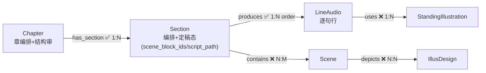

# 04 剧情

galgame 运行时剧本的编排层：章（Chapter）→ 节（Section）→ 逐句台词行（LineAudio）。节级产物（小说.md / 台词.ink）为纯文件，不入图；图存结构真相（行）与最小状态（Section 定稿态）。

---

## 节点

### 章节（Chapter）

每章一个。章级编排锚点 + 结构段审批锚点；章的叙事范围由**事件时间线**承载（调用方建章时给定时间窗/事件范围），不存图字段。

| 字段 | 中文 | 类型 | 必填 | 说明 |
|------|------|------|------|------|
| id | 编号 | string | 是 | snowflake Base62 |
| title | 标题 | string | 是 | `新皮肤·Day0` |
| chapter_no | 章节序号 | int | 是 | `1` |
| status | 流程状态 | int | 否 | `0` |

**status 枚举**：`0` 待编排 → `10` 结构待审 → `11` 结构已批。驳回归 `0`，作废 `-1`。（`summary`/`branch_summary` 字段已废止 2026-10-23，存量属性已清。）

> `Chapter.status==11` 只代表结构已批；章可发布 = `Chapter.status==11` AND 全部节 Section.status=11 ∧ 行全 11 AND 所需立绘全 11（派生判断，非字段）。

---

### 节（Section）

每章若干节，编排容器 + 定稿态载体。节级产物为纯文件：小说.md（chapter-novelist 产，零图写入）与 台词.ink（chapter-dialoguer 产，本节点 `script_path` 指向）；小说已产判据 = 节目录文件存在（`25_剧本/chapter<NN>_<章概述>/sec<MM>_<节概述>/小说.md`），新鲜度 = 文件头部取材指纹（skill 层自检，非图状态）。

| 字段 | 中文 | 类型 | 必填 | 说明 |
|------|------|------|------|------|
| id | 编号 | string | 是 | snowflake Base62 |
| section_no | 节序号 | int | 是 | `0`（章内从 0 起；排序权威 + 文件名 `<MM>` 来源） |
| title | 标题 | string | 是 | `酒店清晨` |
| summary | 概要 | string | 否 | 本节戏剧职责 |
| time_day | 叙事日期 | string | 否 | `2024-06-12`（yyyy-MM-dd；chapter-novelist 圈定取材的时间窗） |
| scene_block_ids | 场景块 id 清单 | string(JSON) | 否 | `["s00_hotel","s00_lobby"]` 有序数组——structurer 预分配的块 id（章内唯一，ASCII 字母数字下划线、禁连字符），小说 `###` 标题与 ink 场景块的唯一合法 id 来源；按行序由拆分回填/结构段写入 |
| script_path | 定稿路径 | string | 否 | `25_剧本/chapter01_新皮肤/sec00_酒店清晨/台词.ink`（人读/人改定稿，ink 方言；确认与拆分均以它为准） |
| scene_blocks | 场景块定义 | string(JSON) | 否 | `[{"block":"s01_咖啡店","scene_name":"街角咖啡店-点餐台"}, …]` 有序数组——场景块的图上落点，拆分时写入；投影时按 scene_name JOIN Scene 取 `time_of_day` |
| status | 定稿状态 | int | 否 | `0` |

**status 枚举**：`0` 待定稿 → `1` 草稿（llm 占位未提审）→ `10` 定稿待人过目 → `11` 定稿已确认。驳回归 `0`，作废 `-1`。dashboard 定稿编辑器**保存即 11**（人工编辑视为已过目）。

---

### 台词行（LineAudio）

一句台词/旁白/结构行，每行一个节点。节点 id 即行身份（voice key 末段，插入/删除行不漂移）；wav 母带按 `15_声音/<chapter_stem>/<scene_block_id>/<key>.wav` 落盘。

| 字段 | 中文 | 类型 | 必填 | 说明 |
|------|------|------|------|------|
| id | 编号 | string | 是 | snowflake Base62（= 行身份） |
| name | 名称 | string | 是 | 行正文本身（= text） |
| op | 行类型 | enum | 是 | `say`/`narrate`/`transition`/`bed_start`/`bed_end`/`label`/`choice`/`hide`/`ending`。**transition**=点状音效（1~2s 播完再接下一句）；**bed_start/bed_end**=音床起止对（区间声景循环，同块配对）；**choice**=选择行（连续 `*`/`+` 聚合一条）；**hide**=立绘下台指令（清 slots 角色槽）；场景标题不进行（块定义在 Section.scene_blocks） |
| who | 说话人 | string | 否 | say 行必填（Character.name 原名） |
| pos | 立绘位 | enum | 否 | `left`/`center`/`right`；拆分按块内规则自动分配（1 人 center / 2 人先左后右 / ≥3 人按首话序），定稿 `pos:` 行可覆盖 |
| text | 台词原文 | string | 否 | 投影字幕用 |
| tts_text | 配音变体 | string | 否 | 仅 say 行；TTS 实际输入（标点/停顿级修饰，禁增删改汉字）；不得写回 text |
| kind | 结局类型 | enum | 否 | 仅 op=ending：`BE`/`TE`/`HE`/`NE` |
| options | 选项清单 | json string | 否 | 仅 op=choice：`[{label, to \| scene \| leads_to_ending+kind}]`；签名=options 序列化 |
| bed | 音床标识 | string | 否 | 仅 bed_start/bed_end：`[A-Za-z0-9_]+`，同 scene_block 配对 |
| prompt | 生成提示 | string | 否 | 仅 bed_start：AudioFly 英文提示；重产复用 |
| scene_block_id | 场景块 | string | 否 | 所有行：块归属（块→场景映射见 Section.scene_blocks）；ASCII 禁连字符（voice key 解析约束） |
| voice_key | 配音键 | string | 否 | `<char>-<chapter_stem>-<scene_block_id>-<行id>`，配音后写 |
| ambient_track | 环境音键 | string | 否 | 仅 transition/bed_start 行：`<prefix>-<chapter_stem>-<scene_block_id>-<行id>`（prefix=amb/bed，终身不换） |
| emotion | 情绪 | string | 否 | 配音期判别（12 词表）；标注用，不进合成参数 |
| clone_mode | 克隆模式 | enum | 否 | 仅 say 行：`icl`（ref 韵律迁移，缺省）/ `xvec`（文本主导演绎） |
| attempts | 尝试次数 | int | 否 | 重配计数；`status=0 且 attempts>0` = 被驳回 |
| text_sha1 | 文本指纹 | string | 否 | sha1(text)，重拆对齐/stale 判定依据 |
| status | 流程状态 | int | 否 | `0` |

**status 枚举**：`0` 待配音/被驳回 → `10` 配完待审 → `11` 已批。作废 `-1`（sync 级联）。音频行（say/transition/bed_start）走 `0→10→11`；非音频行（narrate/label/ending/choice/hide/bed_end）拆分即 `11`。行 status 只代表音频——文字审批在 Section 定稿态完成。

---

## 边

### 章节包含节

#### has_section — `1:N`

- **方向**：`Chapter → Section`

| 属性 | 中文 | 类型 | 必填 | 说明 |
|------|------|------|------|------|
| sync | 同步 | boolean | 否 | 默认 `true`（章属性变更 → 节及其行作废重做） |

> Section 是 Chapter 的独占组成。排序权威是 `section_no` 字段，边上不存 order。

---

### 台词链

#### produces — 节产出台词行 `1:N`

- **方向**：`Section → LineAudio`

| 属性 | 中文 | 类型 | 必填 | 说明 |
|------|------|------|------|------|
| order | 排序 | int | 否 | 行在节内的顺序。大间距——初始 `(i+1)×1000`，句间插入取中点；中点差 <1 全节重排（order 仅排序键，不进 voice key） |
| sync | 同步 | boolean | 否 | 默认 `true`（节属性变更 → 全部行作废） |

> 级联作废后重拆：`text_sha1` 匹配且 wav 在的行恢复 `10`（音频复用），否则 `0` 重配；未变句审批结果保留。

---

### 编排引用

#### contains — 节包含场景 `N:M`

- **方向**：`Section → Scene`

| 属性 | 中文 | 类型 | 必填 | 说明 |
|------|------|------|------|------|
| order | 序号 | int | 否 | 该场景在本节 scene-block 序列中的首次出现位置 |
| sync | 同步 | boolean | 否 | 恒 `false`（编排引用，不级联） |

> 一个 Scene 可被多节/多章引用；同 Scene 重复出现 MERGE 合一条边，完整序列以图行/章 JSON 为权威。

---

#### depicts — 场景引用立绘设计图 `N:N`

- **方向**：`Scene → IllusDesign`

| 属性 | 中文 | 类型 | 必填 | 说明 |
|------|------|------|------|------|
| sync | 同步 | boolean | 否 | 恒 `false`（引用边，不级联） |

> 「该场景的剧本需要此着装立绘可用」。由 section-voice-publisher 选绘 apply 时 MERGE；变体池沿 `Scene-depicts->IllusDesign-expands_to->StandingIllustration` 枚举。

---

#### uses — 台词行使用立绘 `1:N`（每 say 行至多 1 条）

- **方向**：`LineAudio → StandingIllustration`

| 属性 | 中文 | 类型 | 必填 | 说明 |
|------|------|------|------|------|
| sync | 同步 | boolean | 否 | 恒 `false`（行级演出引用，禁止级联） |

> 配音判断期为每句 say 行显式选绘建边（先删旧再 MERGE，幂等替换）；无 uses 边的 say 行 = 选绘缺口，发布期警告、章 JSON 该句 portrait 空串。

---

## 结构图



---

## ID 规则

所有节点使用雪花算法 Base62 编码作为 `id` 属性值（如 `Nv93TkkkgC`），全局唯一，无前缀。由 `.claude/scripts/snowflake_base62.py` 生成。

生成命令：
```bash
python "${CLAUDE_SKILL_DIR}/../../scripts/snowflake_base62.py" -n 1 -q
```

---

## 方向验证

| from | 允许的边 | to |
|------|---------|-----|
| Chapter | has_section | Section |
| Section | produces, contains | LineAudio / Scene |
| LineAudio | uses | StandingIllustration |
| Scene | depicts | IllusDesign |

---
