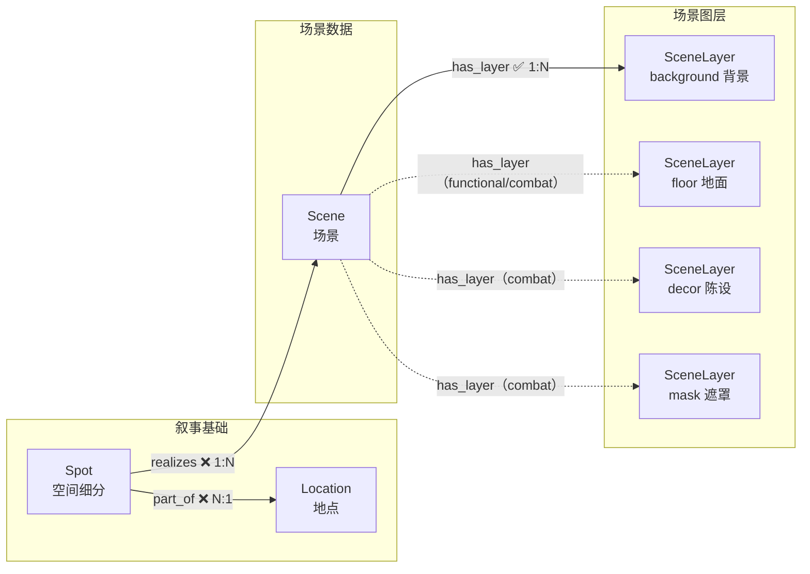

# 03 场景美术

> 场景的渲染与适配——把叙事地点拆解为可生成的场景与图层。

---

> **美术风格**：所有美术风格定义（画风、光线、渲染风格等）统一写入 [00_init/美术风格.md](../../00_init/美术风格.md)，不再存储为图节点。场景风格全局统一，风格词见该文件「提示词硬约束」的风格收尾串。

---

## 节点

> Location 节点定义见 [叙事基础.md](叙事基础.md)。Location 仅保留叙事属性；空间细分由 Spot 承载（见叙事基础.md），视觉信息下沉到 Scene。Scene 不再直接挂 Location——由 Spot realize（恰好 1 个源 Spot）。

### 场景（Scene）

每个 Spot 一个或多个（时段/版本变体各一 Scene）。定义子空间在某时段/版本下的视觉设定。**Scene = 源 Spot 的 room.yml 内一个机位条目**（`scenes[].scene_id` = Scene.id，含 camera/lights；room.yml 路径登记在源 Spot 的 `dsl_path`，见 [叙事基础.md](叙事基础.md)）。纯数据节点，由 `scene-designer` 按 spot 粒度推导（spot 的事件量与叙事密度，含 default 事件的子空间细化归位），创建后即 `status=1`（已完成，无审批）。

| 字段 | 中文 | 类型 | 必填 | 说明 |
|------|------|------|------|------|
| id | 编号 | string | 是 | snowflake Base62 |
| name | 名称 | string | 是 | `[Location名]-[区域]`，如 `咖啡店-点餐台`（可与 zone Spot 同名，label 与 realizes 边已区分）；时段/版本后缀（-更新设备后/-夜晚）只出现在 Scene 名 |
| scene_type | 场景类型 | enum | 是 | `dialogue`（对话背景）/ `functional`（功能场景）/ `combat`（战斗场景）/ `ui`（UI背景）。决定所需图层（见下表） |
| time_of_day | 时段 | string | 否 | 标签：清晨/白天/黄昏/夜晚。出图经 `--tod` 进模式 E prompt；Godot 运行时时段以此为准 |
| atmosphere | 氛围 | string | 否 | 自由文本：整体氛围一句话（含天气表达，如「雨幕笼罩的路口」） |
| deco | 陈设细节 | string | 否 | 自由文本：该机位画面里的陈设/小物描述——可移动小物与杂物堆**不建 room.yml 几何**，视觉表现全写此处（出图时经 `--deco` 传入 slice_scenes.py 拼 prompt；room.yml 的 scene 条目只留几何/数值，不存文字） |
| description | 概要 | string | 否 | 简短场景描述（1-2 句） |
| status | 流程状态 | int | 否 | `0` |

**status 枚举**：`0` 待设计 → `1` 已完成

> **已废止字段**（2026-10-11 全图清理）：weather（并入 atmosphere 表达）、composition（构图=room.yml 机位投影）、lighting（光影=yaml `lights` 数值）、color_direction（配色=美术风格.md 全局风格）。历史出图 prompt.md 存档保留原文。

---

### 场景图层（SceneLayer）

场景的单一图层（传统 2D 游戏 4 层结构）。用 `layer_type` 区分背景/地面/陈设/遮罩；每个场景按 `scene_type` 按需拥有图层节点。由 `scene-layer-designer` 创建并产出提示词与图片。

| 字段 | 中文 | 类型 | 必填 | 说明 |
|------|------|------|------|------|
| id | 编号 | string | 是 | snowflake Base62 |
| name | 名称 | string | 是 | `[Scene名]-[图层中文]`，如 `咖啡店-点餐台-背景` |
| layer_type | 图层类型 | enum | 是 | `background`（背景）/ `floor`（地面）/ `decor`（陈设）/ `mask`（遮罩） |
| prompt_path | 提示词文件 | string | 否 | 派生 prompt 文件相对路径（`07_场景美术/<Location名>/<Spot目录名>/<Scene名>/<layer_type>/prompt.md`），由 assembler 从 Scene 字段 + 美术风格.md 生成 |
| image_path | 图片路径 | string | 否 | `07_场景美术/<Location名>/<Spot目录名>/<Scene名>/<layer_type>/<layer_type>.png`（与 prompt.md 同层——图层子目录内 prompt.md + <layer_type>.png 配对） |
| status | 流程状态 | int | 否 | `0` |

**status 枚举**：`0` 待生成 → `1` 提示词文件已生成 → `2` 图片生成完成 → `10` 待审 → `11` 批准

> **图层渲染顺序**（底→顶）：background 背景 → floor 地面 → decor 陈设 →（角色）→ mask 遮罩。遮罩层渲染在角色之上，形成前景遮挡。

---

## 边

### 场景数据关联

#### realizes — Spot 实现场景 `1:N`

- **方向**：`Spot → Scene`（源头→产物，与原 has_scene 同向：边源端从 Location 平移为 Spot）
- **基数**：每个 Scene 恰好 1 条 realizes 入边；1 个 Spot 可 realize 0..N 个 Scene（时段/版本变体各一 Scene）。

| 属性 | 中文 | 类型 | 必填 | 说明 |
|------|------|------|------|------|
| sync | 同步 | boolean | 否 | **恒 false，禁止 true** |

> **级联语义变更（2026-10-09 已拍板）**：原 has_scene 为 sync=true——Location 属性变更会级联作废其全部 Scene。realizes 换源到 Spot 且 sync=false 后该级联通道消失：改 Location 描述不再作废场景美术。理由：Spot 是空间拓扑事实（name/kind/description 基本不变），「Location.description 改一个字 → 全部场景图作废重出」本就是误伤；若未来确需级联，应经 Scene 自身属性而非挂载边。

---

#### has_layer — 场景拥有图层 `1:N`

- **方向**：`Scene → SceneLayer`

| 属性 | 中文 | 类型 | 必填 | 说明 |
|------|------|------|------|------|
| sync | 同步 | boolean | 否 | 默认 `true`（场景更新级联重置图层） |

---

### scene_type 与所需图层

图层按需：并非每个场景都需要全部 4 层。`scene_type` 决定该场景要创建哪些 `layer_type` 的 SceneLayer 节点。该映射表同时是 `scene-layer-designer` 创建图层节点的依据。

| scene_type | 中文 | 所需图层（layer_type） | 说明 |
|-----------|------|----------------------|------|
| `dialogue` | 对话背景 | `background` | 对话游戏唯一必需层（当前项目 V1 实现） |
| `functional` | 功能场景 | `background`, `floor` | 功能场景加地面层 |
| `combat` | 战斗场景 | `background`, `floor`, `decor`, `mask` | 完整 4 层 |
| `ui` | UI背景 | `background` | UI 背景 |

---

## 结构图

### 场景美术链



> 实线 = dialogue/ui 场景必需的背景层；虚线 = functional/combat 场景按 scene_type 按需添加。

---

## ID 规则

所有节点使用雪花算法 Base62 编码作为 `id` 属性值（如 `Nv93TkkkgC`），全局唯一，无前缀。由 `.claude/scripts/snowflake_base62.py` 生成。

生成命令：
```bash
python "${CLAUDE_SKILL_DIR}/../../scripts/snowflake_base62.py" -n 1 -q
```

引用已有 Location / Spot 时，通过名称从数据库查询：
```cypher
MATCH (l:Location) WHERE l.name='地点名' RETURN l.id AS id
MATCH (sp:Spot) WHERE sp.name='空间名' RETURN sp.id AS id
```

---

## 方向验证

| from | 允许的边 | to |
|------|---------|-----|
| Spot | realizes, part_of | Scene / Location |
| Scene | has_layer, depicts, has_bgm | SceneLayer / IllusDesign / BgmTrack |
| SceneLayer | — | （终端节点，无出边） |
