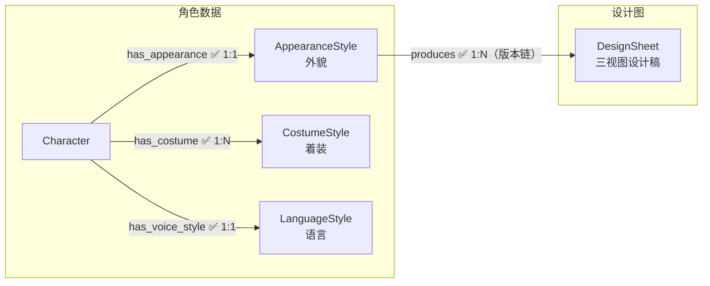
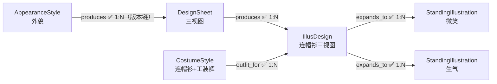

# 02 角色美术

> 角色域——人物是谁（Character 基础属性 + 叙事关联）与如何从文字变成画面。

> **Event 驱动化（已实施）**：`wears`（Event→CostumeStyle）废弃删除，新边 `appears_as` 直挂形象版本（端点已随 SubEvent 细化层下沉为 SubEvent→IllusDesign）；`ref_style`（LanguageStyle→StandingIllustration）删除，立绘取语言风格改经 `Character→has_voice_style` 反查。

> **id 锚定（2026-10-31 全量迁移）**：产物目录/文件名一律用节点 id 的 **hexid**（`to_hexid(id)` 16 位小写 hex，`snowflake_base62.py`，与 Base62 互逆；NTFS 大小写不敏感与 Base62 不兼容故文件名禁裸 id）——节点 name 改名零漂移。目录结构 = 图链路径：`06_角色美术/<char_id>/<ds_id>/`（DesignSheet 层）→ `…/<costume_id>/`（IllusDesign 层）→ `…/立绘/<stand_id>/`（变体层）。各 id 段查图得（如 `MATCH (c:Character {name:'陆择'}) RETURN c.id`）。

---

## 设计总纲：人物建模的逐层细化

整条角色美术链是**给人物建模的细化过程**，三个"是什么"各有一个单一事实源：

| 建模维度 | 单一事实源 | 一句话定义 |
|---|---|---|
| **这是个什么人** | [Lore](剧情.md)（+at 边） | 身份事实：职业、家世、与谁有何关系 |
| **视觉看上去如何** | vibe + AppearanceStyle | vibe=恒定调性（气质+配色方向）；AppearanceStyle=客观外貌（结构化字段） |
| **习惯怎么说话** | speech_style（LanguageStyle） | 底色腔调+五境变形规则 |

往下接物化层：

```
这是谁（Lore / vibe / speech_style —— 三个"是什么"）
    ↓ 细化为
长什么样（AppearanceStyle 客观外貌 + CostumeStyle 着装）
    ↓ 物化为
画出来（DesignSheet → IllusDesign → StandingIllustration 生产链）
```

**字段判定基准**：任何字段新增或改写前问——它属于哪个建模维度？若与既有事实源的语义重叠（气质写进外貌、身份写进速览、人设写进语言），即违背设计意图，须归位到对应事实源。

---

## 节点

### 角色（Character）

最小粒度：每个有名字的真实人物。角色实体的一站式定义（基础属性 + vibe 调性 + 占位标记）；挂靠事件（`involved`）与固有设定（`has_info`）的边定义见 [剧情.md](剧情.md)。

| 字段 | 中文 | 类型 | 必填 | 示例 |
|------|------|------|------|------|
| id | 编号 | string | 是 | snowflake Base62 |
| name | 姓名 | string | 是 | `陆择` |
| gender | 性别 | enum | 否 | `男` / `女` |
| birth_year | 出生年份 | int | 否 | `2003` |
| ref_image_path | 参考图路径 | string | 否 | `06_角色美术/<char_id>/参考图.jpg`（hexid 段；dashboard 上传时 SET，char-design-sheet 探测读属性） |
| priority | 优先级 | enum | 否 | `P0` / `P1` / `P2`：制作优先级，P0 最优先（分组即本字段值，以图上 Character 现状为准） |
| vibe | 设计氛围 | string | 否 | 人物调性的单一事实源（自由文本，一段有画面感的氛围描述；生成规范见下方「vibe 生成规范」） |
| status | 占位标记 | int | 否 | 仅占位语义：`0`=占位待建档（event-ideator/stager 经建议 JSON 建，char-design 圈占位消化）；消化建档后 **REMOVE 归空**。非生产流水线状态 |

**vibe 生成规范**（核心思想：把人物的性格内核，翻译成感官可感的调性——不是在描述这个角色，而是在给这个角色「定调」）：

1. **源头是性格，落点是感官**——输入是「他骨子里是什么样的人」，输出必须是通感表达：这段性格看起来是什么颜色、摸起来是什么质感、走进房间时空气怎么变。性格直述（「外冷内热」）不是 vibe，翻译完成（「冷调象牙白与深酒红的克制，暗金点睛」）才是。
2. **一段文本服务三个创作端**——造型师选面料配色、声线师定音色气质、写手定出场氛围，读同一段话取到的味道必须一致。写前自问：这三个人拿到这段话，各自知道往哪个方向使劲吗？
3. **只写恒定调性，不写任何会变的东西**——生理外貌（发色/瞳色/肤色/体型）归 AppearanceStyle 结构化字段；设定事实（职业/家世/经历/能力）归 Lore；剧情因果归 Event。检验法：**把这段话放在第一章和最后一章，它都还成立吗？** 成立才是 vibe；会过时的说明写进事实了。

---

### 语言风格（LanguageStyle）

每个角色一个。定义角色的**语言行为模式**（说话方式/语气/口头禅/情境表达变化）——仅此职责，不是人设速览（人物调性读 Character.vibe，身份事实读 Lore）。立绘的表情和动作参考语言风格生成。

**speech_style 生成规范**（核心思想：写「这个人每种情绪下开口是什么样」——给语言定腔调，不是摘录台词）：

1. **底色一句定腔调**——词汇域+人称姿态（「电竞直播圈口语全开的女王腔」），来源是性格与处境，落点是可执行的语言模式。
2. **五境分述作主干**——平静/紧张/愤怒/悲伤/轻松各一句，写「情绪来了语言怎么变形」（句长/语速/音量/词汇域的变化），三端（对白/声线/表情）按当前情境直接定位取材。
3. **只写恒定模式，不写一次性内容**——例句台词不写（对白锚点归正文/ink）；身份事实不写（归 Lore）；负面清单不写（可从气质推导）；情绪写变形规则不写那一次。口头禅本体（「哟」「行」「嗯……」）允许原样保留——必须逐字进对白的语言事实。检验法：换一个场景这段描述还成立吗？

| 字段 | 中文 | 类型 | 必填 | 说明 |
|------|------|------|------|------|
| id | 编号 | string | 是 | snowflake Base62 |
| name | 名称 | string | 是 | `[角色名]语言风格` |
| speech_style | 说话风格 | string | 否 | 一段自由文本：语言行为的单一事实源（情绪为轴，生成规范见下） |
| status | 流程状态 | int | 否 | `0` |

**status 枚举**：`0` 待设计 → `1` 已完成

---

### 外貌特征（AppearanceStyle）

每个角色一个。定义角色的固定外貌（脸、体型、发色、瞳色等）。纯数据节点，不参与风格继承。

| 字段 | 中文 | 类型 | 必填 | 说明 |
|------|------|------|------|------|
| id | 编号 | string | 是 | snowflake Base62 |
| name | 名称 | string | 是 | `[角色名]外貌特征` |
| appearance | 外貌描述 | string | 否 | 自由文本：综合气质、身高、整体观感（`约168cm, 曼妙匀称, 慵懒妩媚`） |
| shape_language | 形状语言 | string | 否 | 标签：三角型/方型/倒三角/细长型/圆形/不对称 |
| age_impression | 年龄感 | string | 否 | 标签 |
| body_type | 体态 | string | 否 | 标签 |
| skin_tone | 肤色 | string | 否 | 标签 |
| ethnicity | 面孔/人种 | string | 否 | 标签：中国面孔/日系面孔/韩系面孔/东南亚面孔/欧美面孔/中东面孔/非裔面孔/混血面孔 |
| hair | 头发 | string | 否 | 合成组合（发色+发型+发长）：`深棕色大波浪长发` |
| eye | 眼睛 | string | 否 | 合成组合（瞳色+眼型）：`琥珀色上挑眼` |
| lip_shape | 唇形 | string | 否 | 标签 |
| marks | 特殊标记 | string | 否 | 标签（可多选） |
| height_cm | 身高cm | int | 否 | 数值身高，供立绘显示缩放推算（迁移自 appearance 文本） |
| status | 流程状态 | int | 否 | `0` |

**status 枚举**：`0` 待设计 → `1` 已完成

---

### 着装特征（CostumeStyle）

每套装扮一个节点。定义角色的具体着装（衣物、配饰、材质等）。创建后即 `status=1`（已完成，无审批）。

| 字段 | 中文 | 类型 | 必填 | 说明 |
|------|------|------|------|------|
| id | 编号 | string | 是 | snowflake Base62 |
| name | 名称 | string | 是 | `着装名称`：简短描述（如 `工作服`）——**纯着装名，禁内嵌角色名前缀**（不锚定目录/键，仅展示） |
| outfit_style | 着装风格 | string | 否 | 标签（可多选）：休闲/正式/性感/古风...（多值分隔符统一半角 `;`） |
| garment | 服装 | string | 否 | 合成组合（材质+服装类型）：`棉衬衫`（多件分号：`棉衬衫;黑色丝袜`） |
| footwear | 鞋类 | string | 否 | 标签 |
| accessory_type | 配饰类型 | string | 否 | 标签（可多选） |
| notes | 着装补充说明 | string | 否 | 鞋履发饰、整体氛围与姿态锚点、占位语境（`高跟鞋，佩戴眼镜与项链；姿态干练挺拔`）——着装的自由文本细节层，与 garment 互补；人物气质状态与出图措辞适配不写（2026-11-12 自 IllusDesign.adaptation_notes 迁入并废止原字段） |
| status | 流程状态 | int | 否 | `0` |

**status 枚举**：`0` 待设计 → `1` 已完成

> 无审批流程：着装内容生成后即 `status=1` 已完成，直接参与下游 IllusDesign 生产。

---

### 设计图（DesignSheet）

每角色每版本一个。首版/常规重做为**参考图图生图**——以用户提供的单张真人参考照片为底，`AppearanceStyle` 外貌属性全量作补充特征（冲突以属性为准）；参考图位置由 Character.`ref_image_path` 属性锚定（`06_角色美术/<char_id>/参考图.jpg`，兼容 .png/.jpeg——dashboard 上传自动压缩与规范命名并 SET 属性，或手动放置），缺失时为用户动作阻塞（不回退文生图）。剧情永久外貌变更（剪发/毁容等）时**以参考版设计图为底图生图新增版本**（仅变更 `delta_notes` 口述内容，保持同人物脸部一致），不改写旧版——旧链下游零作废。

| 字段 | 中文 | 类型 | 必填 | 说明 |
|------|------|------|------|------|
| id | 编号 | string | 是 | snowflake Base62 |
| delta_notes | 改动说明 | string | 否 | **增量版本专用**：本版本相对参考版的口述变更描述（如「理发店剪发后：清爽利落的黑色短发，发丝干净有型」），图生图 prompt 变更段的唯一来源；首版留空 |
| active_from | 生效锚点 | int | 否 | `chapter_no*1000+section_no`（ch01/sec02=1002）；空 = 首版（最早恒生效）。取用时取「≤当前叙事位置的最新版本」 |
| prompt_path | 提示词文件 | string | 否 | 派生 prompt 文件相对路径 `06_角色美术/<char_id>/<ds_id>/prompt.md`（hexid 段），由 assembler 从上游 tags + 美术风格.md 生成 |
| image_path | 图片路径 | string | 否 | `06_角色美术/<char_id>/<ds_id>/设计图.png`（hexid 段；slug 版本层已废，多版本各得独立 ds_id 目录） |
| status | 流程状态 | int | 否 | `0` |

**status 枚举**：`0` 待生成 → `10` 待审（图片完成即待审，单轮直推）→ `11` 批准

> ⚠️ 编辑 DesignSheet 属性会沿 sync 边级联作废该版本全部 IllusDesign 与立绘——修正 active_from/delta_notes 前须评估级联影响。

---

### 立绘设计图（IllusDesign）

每个 (DesignSheet, CostumeStyle) 组合一个——同角色同着装可因多版本设计图（如剪发前后）并存多版本。角色穿着特定着装的三视图设计稿——由设计图（外貌基础）和着装特征共同决定。

| 字段 | 中文 | 类型 | 必填 | 说明 |
|------|------|------|------|------|
| id | 编号 | string | 是 | snowflake Base62 |
| prompt_path | 提示词文件 | string | 否 | 派生 prompt 文件相对路径 `06_角色美术/<char_id>/<ds_id>/<costume_id>/prompt.md`（hexid 段） |
| image_path | 图片路径 | string | 否 | `06_角色美术/<char_id>/<ds_id>/<costume_id>/立绘设计图.png`（hexid 段） |
| display_scale | 显示缩放 | float | 否 | 运行时立绘显示缩放（1.0=占满立绘层满高）；留空则按上游 height_cm/REF_HEIGHT 推算 |
| status | 流程状态 | int | 否 | `0` |

**status 枚举**：`0` 待生成 → `10` 待审（图片完成即待审，单轮直推）→ `11` 批准

---

### 立绘（StandingIllustration）

从立绘设计图拓展出的具体变体——不同表情、动作的单张立绘。每张独立节点。表情和动作参考角色的 LanguageStyle 生成。

| 字段 | 中文 | 类型 | 必填 | 说明 |
|------|------|------|------|------|
| id | 编号 | string | 是 | snowflake Base62 |
| prompt_path | 提示词文件 | string | 否 | 派生 prompt 文件相对路径 `06_角色美术/<char_id>/<ds_id>/<costume_id>/立绘/<stand_id>.md`（hexid 段；文件名=本节点 id） |
| image_path | 图片路径 | string | 否 | `06_角色美术/<char_id>/<ds_id>/<costume_id>/立绘/<stand_id>.png`（hexid 段；文件名=本节点 id——运行时立绘键 = hexid(stand_id)，与此同源） |
| variant_label | 变体 | string | 是 | 简短自由词（2~4 字，如 慵懒/玩味/挑眉/茫然/沉吟/庄严/浅笑），不设词表限制 |
| description | 变体氛围 | string | 否 | 该变体所服务台词的氛围/情绪情境说明（如「宿醉初醒被调戏，赔笑周旋，眼神闪躲带讨好」），供出图时把握表情强度、身体朝向与动作张力 |
| eye | 眼部 | string | 否 | 标签 |
| brow | 眉毛 | string | 否 | 标签 |
| mouth | 嘴部 | string | 否 | 标签 |
| head_angle | 头部角度 | string | 否 | 标签 |
| hand | 手部动作 | string | 否 | 标签 |
| foot | 脚部动作 | string | 否 | 标签 |
| status | 流程状态 | int | 否 | `0` |

**status 枚举**：`0` 待生成 → `10` 待审（图片完成即待审，单轮直推）→ `11` 批准

---

## 边

### 角色叙事关联

#### relation — 人物关系 `N:N`

- **方向**：`Character → Character`

| 属性 | 中文 | 类型 | 必填 | 说明 |
|------|------|------|------|------|
| type | 关系类型 | string | 是 | 如"恋爱""亲属""同事""仇人""控制"（控制者→受控者：受控者行为已不由其自身决定的一切形态） |
| detail | 详情 | string | 否 | 如"恋爱中""已分手""姐弟" |
| illus | 本体造型锚 | string | 否 | 仅 type='控制'：控制者穿越时刻的本体 IllusDesign id——控制者内心独白 say 行的选绘穿透锚（配穿越者本体立绘，不要求块内 appears_as 授权） |
| start_time | 开始时间 | string(datetime) | 否 | `yyyy-MM-dd HH:mm:ss`，自时间锚点推算 |
| end_time | 结束时间 | string(datetime) | 否 | 同上（为空表示持续中） |
| sync | 同步 | boolean | 否 | 默认 `false` |

> 关系可随时间变化：如恋人分手后变为仇人，应建两条 relation 边，分别标记不同的时间区间。

---

#### at — 人物—地点 `N:N`

- **方向**：`Character → Location`（Location 节点定义见 [场景美术.md](场景美术.md)）

| 属性 | 中文 | 类型 | 必填 | 说明 |
|------|------|------|------|------|
| type | 关联类型 | string | 是 | 如"居住""前往""工作" |
| detail | 详情 | string | 否 | |
| start_time | 开始时间 | string(datetime) | 否 | `yyyy-MM-dd HH:mm:ss`，自时间锚点推算 |
| end_time | 结束时间 | string(datetime) | 否 | 同上（为空表示持续中） |
| sync | 同步 | boolean | 否 | 默认 `false` |

> 人物挂靠事件（`involved`，Character→Event）与固有设定（`has_info`，Character→Lore）的边定义见 [剧情.md](剧情.md)。

---

### 角色数据关联

#### has_appearance — 角色拥有外貌特征 `1:1`

- **方向**：`Character → AppearanceStyle`

| 属性 | 中文 | 类型 | 必填 | 说明 |
|------|------|------|------|------|
| sync | 同步 | boolean | 否 | 默认 `true` |

---

#### has_costume — 角色拥有着装特征 `1:N`

- **方向**：`Character → CostumeStyle`

| 属性 | 中文 | 类型 | 必填 | 说明 |
|------|------|------|------|------|
| sync | 同步 | boolean | 否 | 默认 `true` |

---

#### appears_as — 事件出场形象 `N:N`

- **方向**：`SubEvent → IllusDesign`
- **约束**：只在 SubEvent 层存在——Event 直挂本边为违规（体检兜查）；无对应 IllusDesign 时不挂空边（留缺口标红）。
- **基数**：每 sub 每出场角色至多 1 条（有既定着装的角色各 1 条，可多角色并存）。
- **版本判定在写边时物化**：取「事件时间时 `DesignSheet.active_from` 已生效的最新版本」（active_from 空 = 首版，最早恒生效）；回填历史事件按 `datetime(e.time)` vs `active_from` 机械选版。读路径零推理。

| 属性 | 中文 | 类型 | 必填 | 说明 |
|------|------|------|------|------|
| detail | 详情 | string | 否 | 着装语境（如"直播首播装"） |
| sync | 同步 | boolean | 否 | 恒 false（叙事域边，无生产下游级联） |

> 消费侧：选绘沿 `Section→includes→Event→refines→SubEvent→appears_as→IllusDesign→expands_to→StandingIllustration` 直读；「同一套衣服」语义经 `IllusDesign←outfit_for←CostumeStyle` 一跳上溯保留。
>
> **Event 驱动化（已实施）**：替代原 `wears`（Event→CostumeStyle）——端点上移直挂形象版本，读时不再做 active_from 推理；「机位内着装唯一」从结构约束降级为校验不变式（同 scene_block 同角色 appears_as 终点不一致 → 标红，人工裁决）。

---

#### has_voice_style — 角色拥有语言风格 `1:1`

- **方向**：`Character → LanguageStyle`

| 属性 | 中文 | 类型 | 必填 | 说明 |
|------|------|------|------|------|
| sync | 同步 | boolean | 否 | 默认 `true` |

---

### 美术生产链

#### produces — 外貌产出设计图 `1:N`

- **方向**：`AppearanceStyle → DesignSheet`
- **说明**：设计图由外貌特征产出（角色不再直接指向设计图）。剧情永久外貌变更（如剪发）时以参考版设计图为底**图生图新增版本**（DesignSheet 带 delta_notes/active_from），不改写旧版——旧链下游零作废

| 属性 | 中文 | 类型 | 必填 | 说明 |
|------|------|------|------|------|
| sync | 同步 | boolean | 否 | 默认 `true` |

---

#### produces — 设计图产出立绘设计图 `1:N`

- **方向**：`DesignSheet → IllusDesign`

| 属性 | 中文 | 类型 | 必填 | 说明 |
|------|------|------|------|------|
| sync | 同步 | boolean | 否 | 默认 `true`（设计图更新级联重置立绘设计图） |

---

#### outfit_for — 着装提供方案 `1:N`

- **方向**：`CostumeStyle → IllusDesign`
- **说明**：每 (DesignSheet, CostumeStyle) 组合一个——同着装在不同设计图版本（如剪发前后）下各一个 IllusDesign

| 属性 | 中文 | 类型 | 必填 | 说明 |
|------|------|------|------|------|
| sync | 同步 | boolean | 否 | 默认 `true`（着装更新级联重置其全部版本的立绘设计图） |

---

#### expands_to — 拓展出立绘 `1:N`

- **方向**：`IllusDesign → StandingIllustration`

| 属性 | 中文 | 类型 | 必填 | 说明 |
|------|------|------|------|------|
| variant_label | 变体标签 | string | 是 | 如"微笑""生气""行走""待机" |
| sync | 同步 | boolean | 否 | 默认 `true` |

---

#### ref_style — 语言风格参考 `1:N`（**已删除**）

- **已删除（Event 驱动化，随迁移完成）**：原方向 `LanguageStyle → StandingIllustration`（sync 默认 true），用途为「立绘的表情和动作参考角色语言风格生成」。
- 取材替代路径：`StandingIllustration ←expands_to← IllusDesign ←…← Character →has_voice_style→ LanguageStyle`（前驱查询反查）。
- 已接受的代价：该边原为 sync=true 级联通道——删除后语言风格变更不再自动作废立绘（立绘重生成由变体需求驱动，非语言风格驱动）。

---

## 结构图

### 角色美术链



> 角色美术链聚焦数据输入。DesignSheet 及下游的生产链见下方「立绘交叉关系」图。

### 立绘交叉关系



> 立绘的表情/动作取材语言风格：经 `Character→has_voice_style→LanguageStyle` 反查（原 ref_style 直连边已删除）。

> IllusDesign 由两个上游共同决定：DesignSheet（外貌基础）、CostumeStyle（着装方案）。

---

## ID 规则

所有节点使用雪花算法 Base62 编码作为 `id` 属性值（如 `Nv93TkkkgC`），全局唯一，无前缀。由 `.claude/scripts/snowflake_base62.py` 生成。

生成命令：
```bash
python "${CLAUDE_SKILL_DIR}/../../scripts/snowflake_base62.py" -n 1 -q
```

引用已有角色时，通过名称从数据库查询：
```cypher
MATCH (c:Character) WHERE c.name='角色名' RETURN c.id AS id
```

---

## 方向验证

| from | 允许的边 | to |
|------|---------|-----|
| Character | relation, at, has_appearance, has_costume, has_voice_style, has_voice_design*, involved*, has_info* | Character / Location / AppearanceStyle / CostumeStyle / LanguageStyle / VoiceDesign / Event / Lore |
| AppearanceStyle | produces | DesignSheet |
| CostumeStyle | outfit_for | IllusDesign |
| DesignSheet | produces | IllusDesign |
| IllusDesign | expands_to | StandingIllustration |
| SubEvent | appears_as | IllusDesign |
| StandingIllustration | — | （终端节点，无出边；剧情层的 `LineAudio -[:uses]->` 指向它，边定义见 [剧情.md](剧情.md)） |

> 带 * 的边（involved/has_info 定义见 [剧情.md](剧情.md)；has_voice_design 定义见 [声音.md](声音.md)）。
