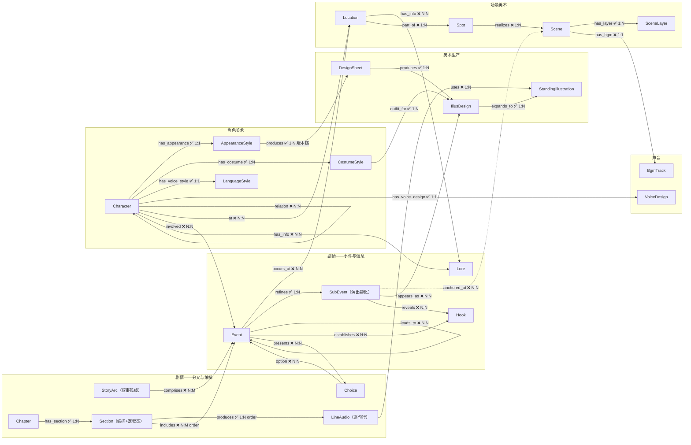
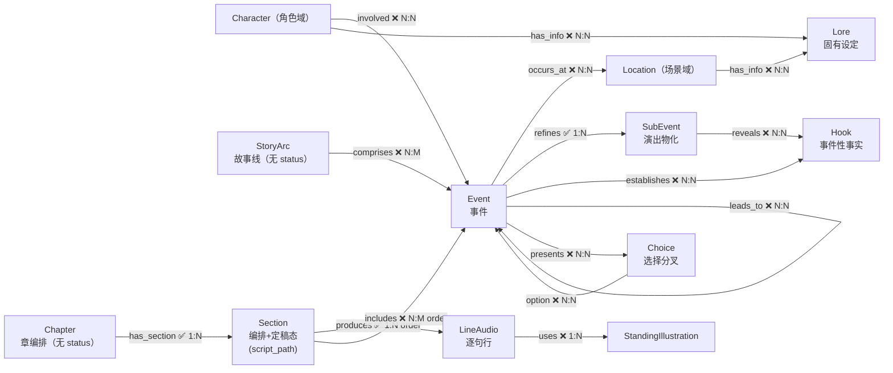
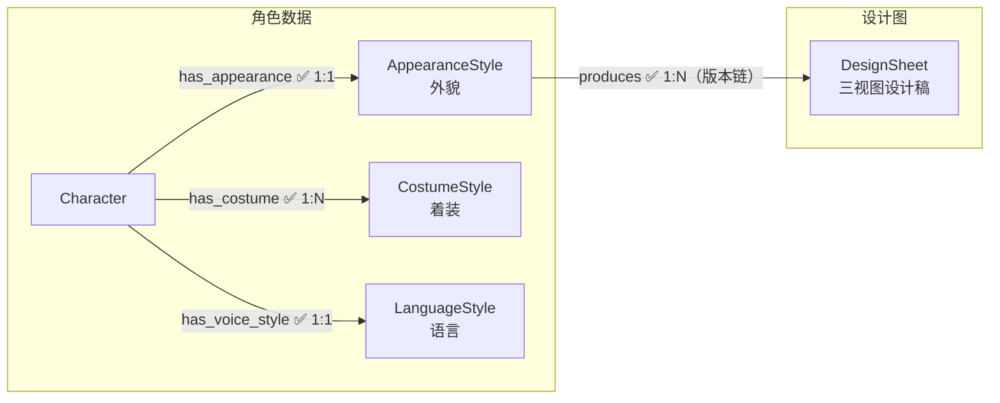
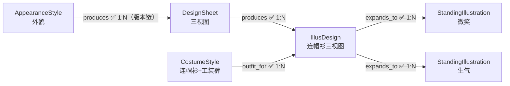
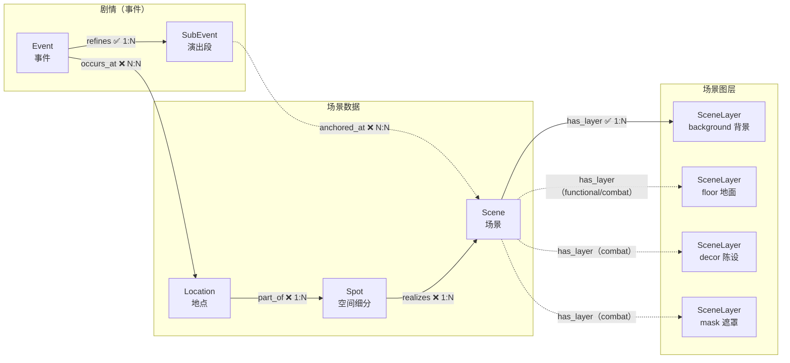

# 代恋 Schema 总览

> Schema 按模块拆分，渐进式披露。每个文件自包含节点定义、边定义、ID 规则。

> **Event 驱动化（已实施）**：新增 `includes`（Section→Event）与 `appears_as`（SubEvent→IllusDesign，端点已随 SubEvent 细化层下沉）；`anchored_at` 端点 Spot→Scene 后再由 Event 下沉至 SubEvent；`part_of` 翻转为 Location→Spot；删除 `contains`/`depicts`/`ref_style`/旧 `wears`。详见各模块文件。

---

## 全局规则

**边方向原则**：所有边方向统一为 **上游（被继承者/源头）→ 下游（继承者/消费者）**。

**同步机制**：每条边都有 `sync` 属性（boolean）。当上游节点更新时，所有 `sync=true` 的出边指向的下游节点 status 重置为 `-1`（作废重做，须重新生成并覆盖旧产物）。同步沿边方向级联传播。

---

## 模块索引

| 文件 | 内容 | 核心节点 |
|------|------|---------|
| [Schema/剧情/](Schema/剧情/) | 叙事与剧情数据——每节点一文件 + 边.md | Event, SubEvent, Hook, Lore, Choice, StoryArc, Chapter, Section, LineAudio |
| [Schema/角色美术/](Schema/角色美术/) | 角色域——每节点一文件 + 边.md | Character, AppearanceStyle, CostumeStyle, LanguageStyle, DesignSheet, IllusDesign, StandingIllustration |
| [Schema/场景美术/](Schema/场景美术/) | 空间域——每节点一文件 + 边.md | Location, Spot, Scene, SceneLayer |
| [Schema/声音/](Schema/声音/) | 角色如何从文字变成声音 + 场景 BGM——每节点一文件 + 边.md | VoiceDesign, BgmTrack |
| ~~属性撰写规范.md~~（已分发并入各模块） | 内容规范随各模块字段表就地承载；跨域总则四条/vibe 四问/标签族纪律/反模式速查见本文末「属性撰写总则」节 | （横切全部模块） |

---

## 全节点速查

> 所有节点 ID 使用雪花算法 Base62 编码（如 `Nv93TkkkgC`），全局唯一、无前缀，由 `.claude/scripts/snowflake_base62.py` 生成；引用已有节点时通过名称从数据库查询 ID，不依赖前缀推断。

**剧情——事件与信息**
- **Event** — 某时某刻发生的某件事
- **SubEvent** — 事件在机位层的演出物化（到场/换区/离开/换装）；挂 anchored_at/appears_as/reveals 三边，无 status
- **Hook** — 一条事件性事实（Event 记「发生」，Hook 记「埋设」；establishes 成立、sub reveals 揭示）
- **Lore** — 一条固有设定（角色/地点的固有事实；has_info 宿主挂靠，无揭示时刻，暴露节奏归写作层遗忘曲线）

**剧情——分叉与编排**
- **Choice** — 玩家选择分叉点（galgame 选项；Event presents 触发、option 导向后续）
- **StoryArc** — 叙事弧线规划（主旨/氛围短文 + comprises 圈骨架成员——非全量入线；无 status）
- **Chapter** — 剧本章节编排单元（无 status；自由节事后归组，组章即结构就绪）
- **Section** — 节编排容器 + 定稿态载体（script_path 指 台词.ink + status 定稿态；节成员=includes 物化、时间由成员推导）
- **LineAudio** — 逐句台词行（节点 id=行身份；行 status 只代表音频审批 0→10→11，非 say 行拆分即 11）

**角色美术**
- **Character** — 有名字的人物（vibe=人物调性单一事实源；relation/at 叙事关联）
- **LanguageStyle** — 角色说话方式、语气、口头禅
- **AppearanceStyle** — 角色固定外貌（脸、体型、发色）
- **CostumeStyle** — 角色着装（衣物、配饰）
- **DesignSheet** — 角色三视图设计稿（版本链：剪发等永久变更图生图新增版本，active_from 时间线分流）
- **IllusDesign** — 着装适配立绘设计图（每 (DesignSheet, CostumeStyle) 组合一个）
- **StandingIllustration** — 具体表情/动作的单张立绘

**场景美术**
- **Location** — 具体地点/游戏场景
- **Spot** — 地点内子空间（zone）；sub 归组经 anchored_at 直挂 Scene；status 仅为占位标记（无审批态）
- **Scene** — 子空间在某时段/版本下的机位视觉设定
- **SceneLayer** — 场景的单一图层（背景/地面/陈设/遮罩）

**声音**
- **VoiceDesign** — 角色基线音色设计（instruct + 参考音频；多候选流程：3 候选 ref + 3×3 情绪试听 → 人工采用固化）
- **BgmTrack** — 场景背景音乐（人工生成链；0→1 描述产出→2 用户手动放 wav 归档；无审批）

---

## 全局边速查

> **时间字段全局约定**：时间类字段（Event.time、relation/at 起止、Choice.time）统一 `yyyy-MM-dd HH:mm:ss` 字符串，自 [游戏概览.md](游戏概览.md)「时间锚点」推算；字符串序即时间序，计算用 `datetime()` 现场转换。

| 边 | 从 → 到 | 基数 | sync | 说明 |
|----|---------|------|------|------|
| **剧情——事件与信息** | | | | |
| involved | Character → Event | N:N | ❌ | 人物参与事件 |
| occurs_at | Event → Location | N:N | ❌ | 事件发生地点（一跳；跨地点事件多挂；子空间归组见 anchored_at） |
| refines | Event → SubEvent | 1:N | ✅ | 细化（父→子）；父属性变更级联作废 sub 重细化 |
| leads_to | Event → Event | N:N | ❌ | 导致——叙事层唯一因果边，仅事件之间（先后时序由 Event.time 承载，evt_relation 已废止；事件↔信息归 establishes/reveals） |
| establishes | Event → Hook | N:N | ❌ | **事实成立**（成立轴）——Hook 因源事件成立（递交辞呈→沈暮雪辞职）；event-ideator 产；原 link 边已废止（Char/Loc 固有事实 2026-11-11 起走 has_info→Lore） |
| has_info | (Character\|Location) → Lore | N:N | ❌ | **固有设定宿主**（宿主轴）——Lore 是宿主角色/地点的固有事实（陆择→陆择是海王）；构图期人工拍板 |
| reveals | SubEvent → Hook | N:N | ❌ | **读者侧揭示**（揭示轴）——读者通过该场戏知晓该 Hook（信息释放时刻锚点，2026-11-11 自 Event 下沉）；event-stager 拆 sub 时逐 sub 拍；目标为 Lore / 源为 Event 均违规 |
| **剧情——分叉与编排** | | | | |
| presents | Event → Choice | N:N | ❌ | 事件触发选择 |
| option | Choice → Event | N:N | ❌ | 选项导向后续事件 |
| comprises | StoryArc → Event | N:M | ❌ | 故事线包含事件（叙事规划层，无 order——次序由 Event.time + description 承载） |
| has_section | Chapter → Section | 1:N | ✅ | 章→节（组成关系，级联重做） |
| produces | Section → LineAudio | 1:N | ✅ | 节产出**逐句台词行**（order 大间距排序：初始 ×1000，句间插入取中点；节属性变更→全部行作废，重拆按 text_sha1 恢复未变句；小说素材变动时显式作废） |
| includes | Section → Event | N:M | ❌ | 节包含事件（order=事件 time 序；节成员物化，替代原 contains） |
| uses | LineAudio → StandingIllustration | 1:N | ❌ | 台词行使用立绘（每 say 行至多 1 条；行级演出引用，禁止级联） |
| **角色美术** | | | | |
| relation | Character → Character | N:N | ❌ | 人物关系 |
| at | Character → Location | N:N | ❌ | 人物—地点 |
| has_appearance | Character → AppearanceStyle | 1:1 | ✅ | 角色外貌 |
| has_costume | Character → CostumeStyle | 1:N | ✅ | 角色着装 |
| has_voice_style | Character → LanguageStyle | 1:1 | ✅ | 角色语言风格 |
| has_voice_design | Character → VoiceDesign | 1:1 | ✅ | 角色基线音色设计（区别于 has_voice_style 的文字风格） |
| produces | AppearanceStyle → DesignSheet | 1:N | ✅ | 外貌产出设计图（版本链：永久变更图生图新增版本） |
| produces | DesignSheet → IllusDesign | 1:N | ✅ | 设计图→立绘设计图 |
| outfit_for | CostumeStyle → IllusDesign | 1:N | ✅ | 着装→立绘设计图（每 (DesignSheet, CostumeStyle) 组合一个） |
| appears_as | SubEvent → IllusDesign | N:N | ❌ | 演出段出场形象（直挂形象版本；写边时按 active_from 选版，读零推理；每 sub 每角色至多 1 条） |
| expands_to | IllusDesign → StandingIllustration | 1:N | ✅ | 拓展表情/动作变体 |
| **场景美术** | | | | |
| anchored_at | SubEvent → Scene | N:N | ❌ | 演出段机位归组（默认每段挂 1 个机位 Scene） |
| part_of | Location → Spot | 1:N | ❌ | 空间从属（父→子；每 Spot 恰 1 入边） |
| realizes | Spot → Scene | 1:N | ❌ | Spot 实现场景（原 has_scene，sync 语义变更见场景美术.md） |
| has_layer | Scene → SceneLayer | 1:N | ✅ | 场景→图层 |
| **声音** | | | | |
| has_bgm | Scene → BgmTrack | 1:1 | ❌ | 场景→背景音乐（BGM 独立资产不级联；scene-design 编排推进） |

---

## 全局结构图



---

# 四域总纲（原各模块 .md 总纲/结构图/ID 规则/方向验证并入，2026-11-13）

## 剧情域

> 本文件定义全部叙事与剧情数据实体：**事件与信息**（Event / SubEvent / Hook / Lore——**Event 记「发生」，Hook 记「埋设」，Lore 记「固有」**）、**选择分叉与故事线**（Choice / StoryArc）、**剧本编排**（Chapter / Section / LineAudio）。人物实体（Character）见 [角色美术/Character.md](角色美术/Character.md)；空间实体（Location / Spot / Scene）见 [场景美术/](场景美术/) 各节点文件。「事件与信息 + 选择分叉/故事线」即旧称的**叙事基础域**（原独立文件已并入本文件）。

> `includes`（Section→Event）承载节成员与顺序；选绘沿 `Section→includes→Event→refines→SubEvent→appears_as→IllusDesign` 直读。

> **id 锚定（2026-10-31 全量迁移；25 域 11-01 改编号锚定）**：产物目录/文件名/运行时键不锚节点 name——改名零漂移。六域中 25_剧本 用**编号目录** `25_剧本/ch<NN>/sec<MM>/`（NN=chapter_no、MM=section_no 零填充，人读区保留可读性；title 改名不动，重排随编号迁移）；其余域用节点 id 的 **hexid**（`to_hexid(id)`，16 位小写 hex）。章 stem = hexid(Chapter.id)（章 JSON/`<stem>.pck` 文件名主体）。

galgame 运行时剧本的编排层：章（Chapter）→ 节（Section）→ 逐句台词行（LineAudio）。**节是第一公民**：节可先于章存在——**自由节**（无所属章，小说/ink 可直写），组章为事后归组（配音前必须组章——voice key 含 chapter_stem）。节级产物（小说.md / 台词.ink）为纯文件，不入图；图存结构真相（行）与最小状态（Section 定稿态）。

---

### 结构图



---

### ID 规则

所有节点使用雪花算法 Base62 编码作为 `id` 属性值（如 `Nv93TkkkgC`），全局唯一，无前缀。由 `.claude/scripts/snowflake_base62.py` 生成。

生成命令：
```bash
python "${CLAUDE_SKILL_DIR}/../../scripts/snowflake_base62.py" -n 1 -q
```

引用已有节点时，通过名称从数据库查询：
```cypher
MATCH (e:Event) WHERE e.title='事件标题' RETURN e.id AS id
MATCH (f:Hook) WHERE f.title='事实标题' RETURN f.id AS id
MATCH (l:Lore) WHERE l.title='设定标题' RETURN l.id AS id
MATCH (ch:Choice) WHERE ch.name='选择名' RETURN ch.id AS id
MATCH (a:StoryArc) WHERE a.title='故事线标题' RETURN a.id AS id
MATCH (c:Chapter) WHERE c.title='章标题' RETURN c.id AS id
```

（Character 查询见 [角色美术/Character.md](角色美术/Character.md)；Location/Spot 见 [场景美术/](场景美术/) 各节点文件。）

---

### 方向验证

| from | 允许的边 | to |
|------|---------|-----|
| Event | occurs_at, leads_to, establishes, presents, refines | Location / Event / Hook / Choice / SubEvent |
| Hook | （无出边——事实终点，只被 establishes/reveals 指向） | — |
| Lore | （无出边——设定终点，只被 has_info 指向） | — |
| SubEvent | anchored_at*, appears_as**, reveals | Scene / IllusDesign / Hook |
| Choice | option | Event |
| StoryArc | comprises | Event |
| Chapter | has_section | Section |
| Section | produces, includes | LineAudio / Event |
| LineAudio | uses | StandingIllustration |

> 带 * 的 anchored_at 定义见 [场景美术/边.md](场景美术/边.md)；带 ** 的 appears_as 定义见 [角色美术/边.md](角色美术/边.md)。Character / Location / Spot / Scene 的出边表见各自域 边.md。

---

## 角色美术域

### 设计总纲：人物建模的逐层细化

整条角色美术链是**给人物建模的细化过程**，三个"是什么"各有一个单一事实源：

| 建模维度 | 单一事实源 | 一句话定义 |
|---|---|---|
| **这是个什么人** | [Lore](剧情/Lore.md)（+at 边） | 身份事实：职业、家世、与谁有何关系 |
| **视觉看上去如何** | vibe + AppearanceStyle | vibe=恒定调性（气质+配色方向）；AppearanceStyle=客观外貌（结构化字段） |
| **习惯怎么说话** | speech_style（LanguageStyle） | 底色腔调+五境变形规则 |

往下接物化层：

```
这是谁（Lore / vibe / speech_style —— 三个"是什么"）
    ↓ 细化为
长什么样（AppearanceStyle 客观外貌 + CostumeStyle 着装）
    ↓ 物化为
画出来（DesignSheet → IllusDesign → StandingIllustration 生产链）
```

**字段判定基准**：任何字段新增或改写前问——它属于哪个建模维度？若与既有事实源的语义重叠（气质写进外貌、身份写进速览、人设写进语言），即违背设计意图，须归位到对应事实源。

---

### 结构图

### 角色美术链



> 角色美术链聚焦数据输入。DesignSheet 及下游的生产链见下方「立绘交叉关系」图。

### 立绘交叉关系



> 立绘的表情/动作取材语言风格：经 `Character→has_voice_style→LanguageStyle` 反查（原 ref_style 直连边已删除）。

> IllusDesign 由两个上游共同决定：DesignSheet（外貌基础）、CostumeStyle（着装方案）。

---

### ID 规则

所有节点使用雪花算法 Base62 编码作为 `id` 属性值（如 `Nv93TkkkgC`），全局唯一，无前缀。由 `.claude/scripts/snowflake_base62.py` 生成。

生成命令：
```bash
python "${CLAUDE_SKILL_DIR}/../../scripts/snowflake_base62.py" -n 1 -q
```

引用已有角色时，通过名称从数据库查询：
```cypher
MATCH (c:Character) WHERE c.name='角色名' RETURN c.id AS id
```

---

### 方向验证

| from | 允许的边 | to |
|------|---------|-----|
| Character | relation, at, has_appearance, has_costume, has_voice_style, has_voice_design*, involved*, has_info* | Character / Location / AppearanceStyle / CostumeStyle / LanguageStyle / VoiceDesign / Event / Lore |
| AppearanceStyle | produces | DesignSheet |
| CostumeStyle | outfit_for | IllusDesign |
| DesignSheet | produces | IllusDesign |
| IllusDesign | expands_to | StandingIllustration |
| SubEvent | appears_as | IllusDesign |
| StandingIllustration | — | （终端节点，无出边；剧情层的 `LineAudio -[:uses]->` 指向它，边定义见 [剧情/边.md](剧情/边.md)） |

> 带 * 的边（involved/has_info 定义见 [剧情/边.md](剧情/边.md)；has_voice_design 定义见 [声音/边.md](声音/边.md)）。

---

## 场景美术域

### 设计总纲：空间建模的逐层细化

整条场景美术链是**给空间建模的细化过程**，与角色美术线同构：

```
这是哪里（Location 空间语义 / Spot 子空间划分 —— 空间定位层）
    ↓ 细化为
什么氛围什么样子（Scene 三件套：vibe 恒定调性 + deco 常驻陈设 + time_of_day 时段）
    ↓ 物化为
画出来（SceneLayer 按 scene_type 分层；构图与光影由 room.yml 机位投影承载）
```

**信息分层的载体对照**（每类信息只住一个载体）：

| 信息 | 载体 |
|---|---|
| 空间定位（这是哪、什么功能区） | Spot.description |
| 画面氛围（什么天气什么感觉，恒定调性） | Scene.vibe |
| 画面陈设（镜头里的常驻小物） | Scene.deco |
| 时段 | Scene.time_of_day |
| 剧情语境（谁在这里发生过什么） | anchored_at 边（归组语义） |
| 一次性演出物（那一次发生的事） | SubEvent |
| 角色持物（人物手里的东西） | IllusDesign / StandingIllustration |
| 构图/光影数值 | room.yml 机位投影 |
| 全局画风/配色 | 美术风格.md |

**字段判定基准**：任何 Spot/Scene 字段新增或改写前问——它属于哪个信息层？与上表既有载体的语义重叠即违背设计意图，须归位到对应载体。

> **id 锚定（2026-10-31 全量迁移）**：产物目录/文件名一律用节点 id 的 **hexid**（`to_hexid(id)`，16 位小写 hex，`snowflake_base62.py`）——Location/Spot/Scene 改名零漂移，name 只作人读。目录结构：`07_场景美术/<location_id>/<spot_id>/<spot_id>.yml`（room.yml 真源）与 `07_场景美术/<location_id>/<spot_id>/<scene_id>/<layer_type>/…`（图层产物）。room.yml **内部**的 `location.name`/`objects[].spot`/`scenes[].scene_name` 等人读字段保留为非权威注记（改名不迁移，仅展示）；机位条目定位一律 `scenes[].scene_id` = Scene.id。

> **Event 驱动化（已实施）**：`anchored_at` 端点由 Spot 上移到 Scene（迁移规则 = 存量边沿 `Spot─realizes→Scene` 一跳重挂）；`part_of` 方向翻转为 `Location → Spot`（父→子，与全局上游→下游约定统一）。

---

> **美术风格**：所有美术风格定义（画风、光线、渲染风格等）统一写入 [00_init/美术风格.md](../../00_init/美术风格.md)，不再存储为图节点。场景风格全局统一，风格词见该文件「提示词硬约束」的风格收尾串。

---

### 结构图

### 场景美术链



> 实线 = dialogue/ui 场景必需的背景层；虚线 = functional/combat 场景按 scene_type 按需添加。

---

### ID 规则

所有节点使用雪花算法 Base62 编码作为 `id` 属性值（如 `Nv93TkkkgC`），全局唯一，无前缀。由 `.claude/scripts/snowflake_base62.py` 生成。

生成命令：
```bash
python "${CLAUDE_SKILL_DIR}/../../scripts/snowflake_base62.py" -n 1 -q
```

引用已有 Location / Spot 时，通过名称从数据库查询：
```cypher
MATCH (l:Location) WHERE l.name='地点名' RETURN l.id AS id
MATCH (sp:Spot) WHERE sp.name='空间名' RETURN sp.id AS id
```

---

### 方向验证

| from | 允许的边 | to |
|------|---------|-----|
| Location | has_info*, part_of | Lore / Spot |
| Spot | realizes | Scene |
| Scene | has_layer, has_bgm* | SceneLayer / BgmTrack |
| SceneLayer | — | （终端节点，无出边） |

> 带 * 的边（has_info 定义见 [剧情/边.md](剧情/边.md)）；has_bgm 定义见 [声音/边.md](声音/边.md)。

---

## 声音域

### ID 规则

snowflake Base62，全局唯一，无前缀（同全项目约定）。生成：`python "${CLAUDE_SKILL_DIR}/../../scripts/snowflake_base62.py" -n 1 -q`

---

---

## 属性撰写总则（原属性撰写规范.md 跨域部分并入，2026-11-13）

> 全部自由文本与标签类属性的撰写规则随各模块字段表就地承载（各表说明列）；本节收跨域通用部分。skill 生产与 dashboard 人工编辑共同遵循。治理对象：LLM 生成字段的三类病——发散（越写越长、散文化）、越界（写到别的载体领地）、漂移（同一字段前后风格不一）。

### 四条总则（一切属性先过）

1. **单一载体（全局不变式，分两侧执行）**：同一事实不允许出现在两个属性里。写入 skill 在生成时刻只有局部视野（目标字段 + 本 skill 查到的数据），无法也不需要枚举全图载体。本不变式由两侧联合保证——
   - **写入侧（防新增）**：规则一律写成**字段级禁则**——「写 X 时禁 Y 类内容」，做性质判定（这是不是情绪/神态/情境/事实？），不要求跨节点查重。各模块字段表的「不写」类说明即此形态。
   - **审计侧（查存量）**：跨节点的同义双写靠全图扫描与 dashboard 体检发现，不指望写入方自查。载体对照表（场景美术.md「信息分层」/ 角色美术.md「人物建模三层」）供审计侧与人工编辑使用。
2. **只存当下有效值**：禁日期注记、推导过程、编号引用、归属标注、变更历史。历史不入图。
3. **正向陈述**：只写「是什么」，不写「不是什么/不再/改为」——否定句在下游生成链会被反向理解。负面红线类内容按既定决策宁可丢不保留。
4. **默认不填**：字段存在需要理由；无增量时留空不是缺陷，是纪律。占位仅允许「内容待补」级最小占位。

### vibe 四问（每个 vibe 写完必过；各域 vibe 的特化表见 角色美术.md / 场景美术.md / 声音.md 各自字段区）

**vibe = 把某物（人/景/表情/乐）的恒定内核翻译成感官可感的调性——不是描述它，是给它定调。**

1. **会变吗**——放在叙事开头和结尾都成立；任何随剧情失效的表述归 Event/SubEvent。
2. **有感官落点吗**——颜色/质感/光线/声音/温度至少落一个；性格或氛围的直白形容不是 vibe，须翻译成通感。
3. **越界了吗**——不写任何归其他载体的事实（见各域特化表）。
4. **够短吗**——按各域约定长度；写不进限定篇幅说明在复述不是在定调。

调性词不互斥：同域多个 vibe 允许共享底色（同角色各变体同气场、同 Location 各 Scene 同基调），但每条必须有自己的区分句——两条 vibe 只差形容词顺序 = 其中一条该删。

### 标签族通用纪律

- **标签就是标签**：短语，不是句子；出现完整句 = 描写化，归 vibe 层重写。
- **多值分隔符统一半角 `;`**，不混用顿号逗号。
- **enum 字段严格取枚举值**，不自造同义词——条件表达式与查询按字面匹配。

### 反模式速查（见到即打回）

1. 情境复述（谁在哪做了什么、台词原文、编号引用）出现在任何非事实族属性
2. 日期/编号引用/人名归属括注——备忘泄漏
3. 否定式描述——改正向
4. 两条同域 vibe 几乎相同——冗余，删一条
5. title 与 description 首句重复——description 砍掉复述
6. 标签字段出现完整句子——描写化
7. enum 字段出现枚举外同义词——漂移
8. content 在做 title 的扩写——删 content
