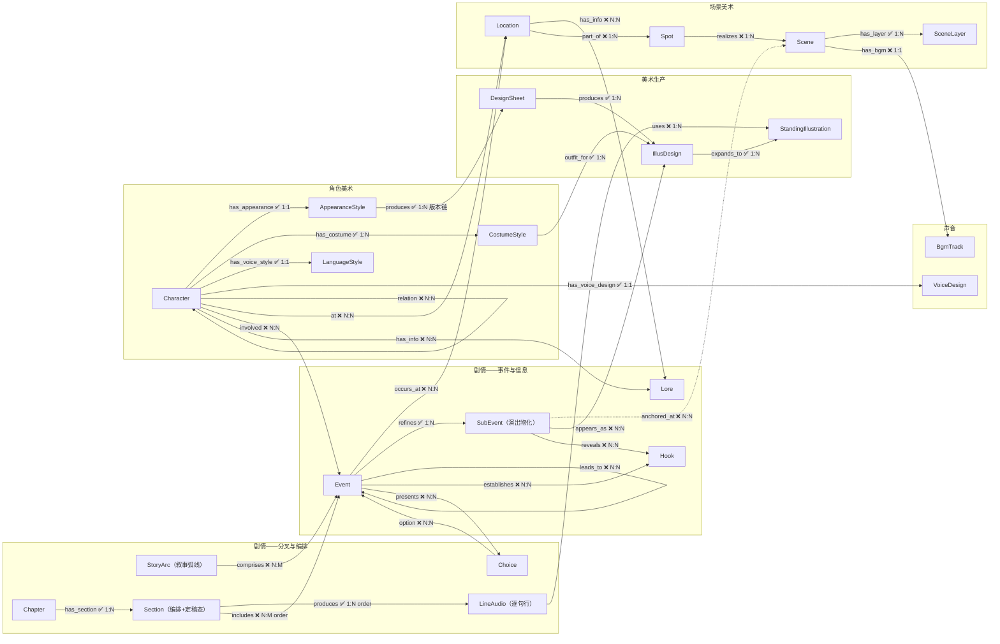

# 代恋 Schema 总览

> Schema 按模块拆分，渐进式披露。每个文件自包含节点定义、边定义、ID 规则。

> **Event 驱动化（已实施）**：新增 `includes`（Section→Event）与 `appears_as`（SubEvent→IllusDesign，端点已随 SubEvent 细化层下沉）；`anchored_at` 端点 Spot→Scene 后再由 Event 下沉至 SubEvent；`part_of` 翻转为 Location→Spot；删除 `contains`/`depicts`/`ref_style`/旧 `wears`。详见各模块文件。

---

## 全局规则

**边方向原则**：所有边方向统一为 **上游（被继承者/源头）→ 下游（继承者/消费者）**。

**同步机制**：每条边都有 `sync` 属性（boolean）。当上游节点更新时，所有 `sync=true` 的出边指向的下游节点 status 重置为 `-1`（作废重做，须重新生成并覆盖旧产物）。同步沿边方向级联传播。

---

## 模块索引

| 文件 | 内容 | 核心节点 |
|------|------|---------|
| [剧情.md](Schema/剧情.md) | 叙事与剧情数据——事件与信息、选择分叉与故事线、章→节→逐句行编排 | Event, SubEvent, Hook, Lore, Choice, StoryArc, Chapter, Section, LineAudio |
| [角色美术.md](Schema/角色美术.md) | 角色域——人物是谁、如何从文字变成画面 | Character, AppearanceStyle, CostumeStyle, LanguageStyle, DesignSheet, IllusDesign, StandingIllustration |
| [场景美术.md](Schema/场景美术.md) | 空间域——地点如何拆解成场景与图层 | Location, Spot, Scene, SceneLayer |
| [声音.md](Schema/声音.md) | 角色如何从文字变成声音 + 场景 BGM | VoiceDesign, BgmTrack |
| [属性撰写规范.md](Schema/属性撰写规范.md) | **内容权威**——全部自由文本/标签属性怎么写：vibe 调性族四问、事实/指令/标签/边语境四族逐属性规范、反模式速查 | （横切全部模块） |

---

## 全节点速查

> 所有节点 ID 使用雪花算法 Base62 编码（如 `Nv93TkkkgC`），全局唯一、无前缀，由 `.claude/scripts/snowflake_base62.py` 生成；引用已有节点时通过名称从数据库查询 ID，不依赖前缀推断。

**剧情——事件与信息**
- **Event** — 某时某刻发生的某件事
- **SubEvent** — 事件在机位层的演出物化（到场/换区/离开/换装）；挂 anchored_at/appears_as/reveals 三边，无 status
- **Hook** — 一条事件性事实（Event 记「发生」，Hook 记「埋设」；establishes 成立、sub reveals 揭示）
- **Lore** — 一条固有设定（角色/地点的固有事实；has_info 宿主挂靠，无揭示时刻，暴露节奏归写作层遗忘曲线）

**剧情——分叉与编排**
- **Choice** — 玩家选择分叉点（galgame 选项；Event presents 触发、option 导向后续）
- **StoryArc** — 叙事弧线规划（主旨/氛围短文 + comprises 圈骨架成员——非全量入线；无 status）
- **Chapter** — 剧本章节编排单元（无 status；自由节事后归组，组章即结构就绪）
- **Section** — 节编排容器 + 定稿态载体（script_path 指 台词.ink + status 定稿态；节成员=includes 物化、时间由成员推导）
- **LineAudio** — 逐句台词行（节点 id=行身份；行 status 只代表音频审批 0→10→11，非 say 行拆分即 11）

**角色美术**
- **Character** — 有名字的人物（vibe=人物调性单一事实源；relation/at 叙事关联）
- **LanguageStyle** — 角色说话方式、语气、口头禅
- **AppearanceStyle** — 角色固定外貌（脸、体型、发色）
- **CostumeStyle** — 角色着装（衣物、配饰）
- **DesignSheet** — 角色三视图设计稿（版本链：剪发等永久变更图生图新增版本，active_from 时间线分流）
- **IllusDesign** — 着装适配立绘设计图（每 (DesignSheet, CostumeStyle) 组合一个）
- **StandingIllustration** — 具体表情/动作的单张立绘

**场景美术**
- **Location** — 具体地点/游戏场景
- **Spot** — 地点内子空间（zone）；sub 归组经 anchored_at 直挂 Scene；status 仅为占位标记（无审批态）
- **Scene** — 子空间在某时段/版本下的机位视觉设定
- **SceneLayer** — 场景的单一图层（背景/地面/陈设/遮罩）

**声音**
- **VoiceDesign** — 角色基线音色设计（instruct + 参考音频；多候选流程：3 候选 ref + 3×3 情绪试听 → 人工采用固化）
- **BgmTrack** — 场景背景音乐（人工生成链；0→1 描述产出→2 用户手动放 wav 归档；无审批）

---

## 全局边速查

> **时间字段全局约定**：时间类字段（Event.time、relation/at 起止、Choice.time）统一 `yyyy-MM-dd HH:mm:ss` 字符串，自 [游戏概览.md](游戏概览.md)「时间锚点」推算；字符串序即时间序，计算用 `datetime()` 现场转换。

| 边 | 从 → 到 | 基数 | sync | 说明 |
|----|---------|------|------|------|
| **剧情——事件与信息** | | | | |
| involved | Character → Event | N:N | ❌ | 人物参与事件 |
| occurs_at | Event → Location | N:N | ❌ | 事件发生地点（一跳；跨地点事件多挂；子空间归组见 anchored_at） |
| refines | Event → SubEvent | 1:N | ✅ | 细化（父→子）；父属性变更级联作废 sub 重细化 |
| leads_to | Event → Event | N:N | ❌ | 导致——叙事层唯一因果边，仅事件之间（先后时序由 Event.time 承载，evt_relation 已废止；事件↔信息归 establishes/reveals） |
| establishes | Event → Hook | N:N | ❌ | **事实成立**（成立轴）——Hook 因源事件成立（递交辞呈→沈暮雪辞职）；event-ideator 产；原 link 边已废止（Char/Loc 固有事实 2026-11-11 起走 has_info→Lore） |
| has_info | (Character\|Location) → Lore | N:N | ❌ | **固有设定宿主**（宿主轴）——Lore 是宿主角色/地点的固有事实（陆择→陆择是海王）；构图期人工拍板 |
| reveals | SubEvent → Hook | N:N | ❌ | **读者侧揭示**（揭示轴）——读者通过该场戏知晓该 Hook（信息释放时刻锚点，2026-11-11 自 Event 下沉）；event-stager 拆 sub 时逐 sub 拍；目标为 Lore / 源为 Event 均违规 |
| **剧情——分叉与编排** | | | | |
| presents | Event → Choice | N:N | ❌ | 事件触发选择 |
| option | Choice → Event | N:N | ❌ | 选项导向后续事件 |
| comprises | StoryArc → Event | N:M | ❌ | 故事线包含事件（叙事规划层，无 order——次序由 Event.time + description 承载） |
| has_section | Chapter → Section | 1:N | ✅ | 章→节（组成关系，级联重做） |
| produces | Section → LineAudio | 1:N | ✅ | 节产出**逐句台词行**（order 大间距排序：初始 ×1000，句间插入取中点；节属性变更→全部行作废，重拆按 text_sha1 恢复未变句；小说素材变动时显式作废） |
| includes | Section → Event | N:M | ❌ | 节包含事件（order=事件 time 序；节成员物化，替代原 contains） |
| uses | LineAudio → StandingIllustration | 1:N | ❌ | 台词行使用立绘（每 say 行至多 1 条；行级演出引用，禁止级联） |
| **角色美术** | | | | |
| relation | Character → Character | N:N | ❌ | 人物关系 |
| at | Character → Location | N:N | ❌ | 人物—地点 |
| has_appearance | Character → AppearanceStyle | 1:1 | ✅ | 角色外貌 |
| has_costume | Character → CostumeStyle | 1:N | ✅ | 角色着装 |
| has_voice_style | Character → LanguageStyle | 1:1 | ✅ | 角色语言风格 |
| has_voice_design | Character → VoiceDesign | 1:1 | ✅ | 角色基线音色设计（区别于 has_voice_style 的文字风格） |
| produces | AppearanceStyle → DesignSheet | 1:N | ✅ | 外貌产出设计图（版本链：永久变更图生图新增版本） |
| produces | DesignSheet → IllusDesign | 1:N | ✅ | 设计图→立绘设计图 |
| outfit_for | CostumeStyle → IllusDesign | 1:N | ✅ | 着装→立绘设计图（每 (DesignSheet, CostumeStyle) 组合一个） |
| appears_as | SubEvent → IllusDesign | N:N | ❌ | 演出段出场形象（直挂形象版本；写边时按 active_from 选版，读零推理；每 sub 每角色至多 1 条） |
| expands_to | IllusDesign → StandingIllustration | 1:N | ✅ | 拓展表情/动作变体 |
| **场景美术** | | | | |
| anchored_at | SubEvent → Scene | N:N | ❌ | 演出段机位归组（默认每段挂 1 个机位 Scene） |
| part_of | Location → Spot | 1:N | ❌ | 空间从属（父→子；每 Spot 恰 1 入边） |
| realizes | Spot → Scene | 1:N | ❌ | Spot 实现场景（原 has_scene，sync 语义变更见场景美术.md） |
| has_layer | Scene → SceneLayer | 1:N | ✅ | 场景→图层 |
| **声音** | | | | |
| has_bgm | Scene → BgmTrack | 1:1 | ❌ | 场景→背景音乐（BGM 独立资产不级联；scene-design 编排推进） |

---

## 全局结构图

