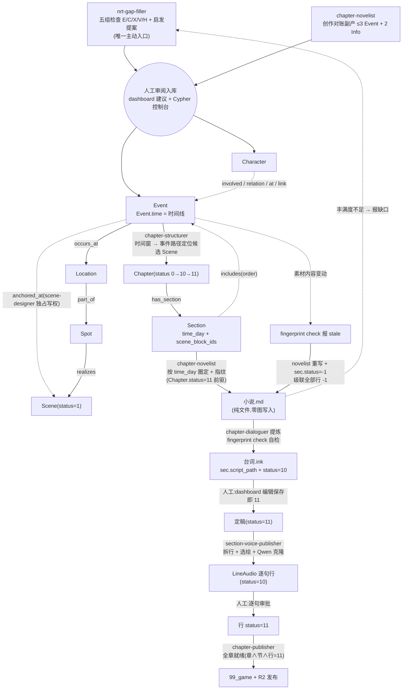
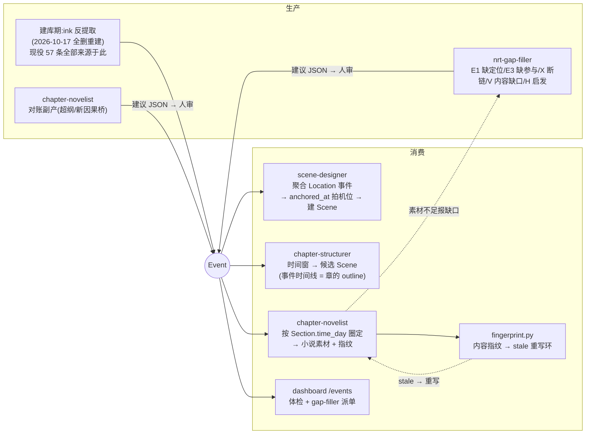
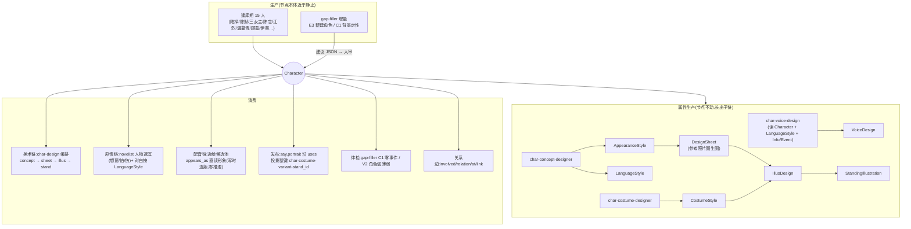
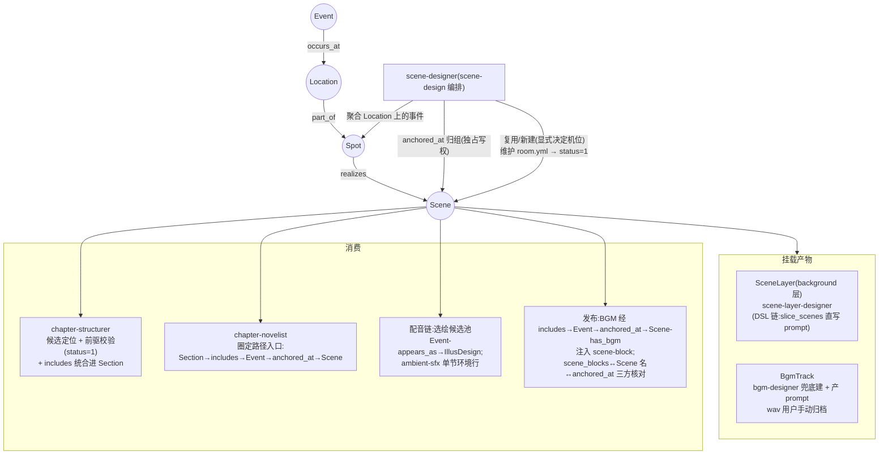

# 叙事流程梳理 · Event / Character / Scene 的生产与消费

> 2026-10-24 梳理快照(最薄图改造 + grower/extractor/graph-builder 废弃 + demo 试产之后)。
> 节点/边 Schema 权威在 `00_init/Schema/`,流程细节权威在各 SKILL.md,本文是三实体生命周期的导览图。
> 文中数量(57 Event / 15 Character / 109 involved)为当日图上实测,非常量。

## 总览(时间线是唯一主轴)

## Event

| 侧 | 要点 |
|---|---|
| 生产 | 收敛为一个半入口:gap-filler(主动)+ novelist(副产),**全部经人工审阅**;反提取是一次性历史 |
| 消费 | 同一个 `Event.time` 被四处复用:场景化归组、建章定位、节取材圈定、变更检测 |
| 已知状态 | involved 边完好(109 条,端点全 :Character);role 属性 59 条缺失(影响小,可不管) |

## Character

| 侧 | 要点 |
|---|---|
| 生产 | 本体建库期一次成型;增量唯一通道 = gap-filler 建议;活跃的是四条子链(美术/声音/着装/关系) |
| 消费 | 出场判定靠 involved(→Event);语感靠 LanguageStyle;形象靠 appears_as 直挂形象版本(多版本判定在写边时,读零推理) |
| 已知状态 | 二队队友未建档(15 人名单无队友)——demo 暴露的唯一硬缺口,应走 gap-filler 建 4 角色 + involved |

## Scene

| 侧 | 要点 |
|---|---|
| 生产 | 事件驱动:scene-designer 从「Location + 其上 occurs_at 事件」现场化生产 Spot/Scene;Scene=机位,room.yml 是 3D 布局真源 |
| 消费 | structurer 的前驱闸门(status=1)、novelist 的取材路径、选绘/环境音/BGM/发布的视觉与听觉载体 |
| 边界 | Spot/Scene 属场景域,scene-designer 独占;gap-filler 不检查不创建;anchored_at 归组边只有 scene-designer 能写 |

## 三条链闭环的枢纽

`Event.time` 一个字段,决定:事件落在哪个机位 Scene → 被哪章哪节圈走 → 素材漂移时该重写谁。

人工闸门只有两处:①叙事基础入库审阅(建议 JSON);②行级逐句音频审批(定稿编辑保存即 11,章/节无审批——2026-10-25 起 Chapter 无 status、Section 创建即 11)——其余全自动。
